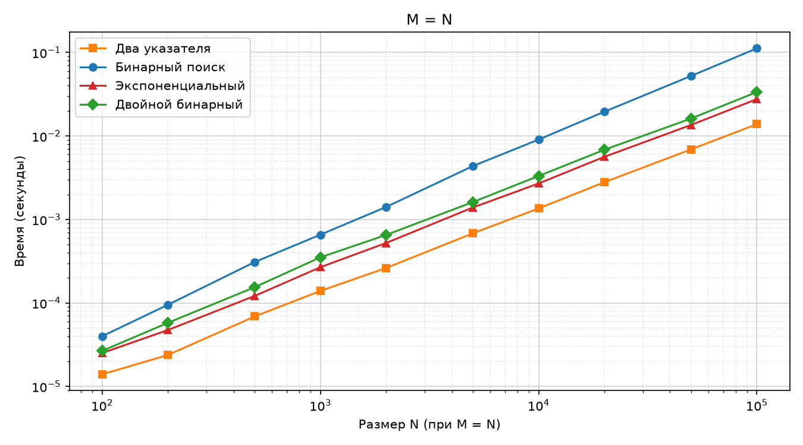
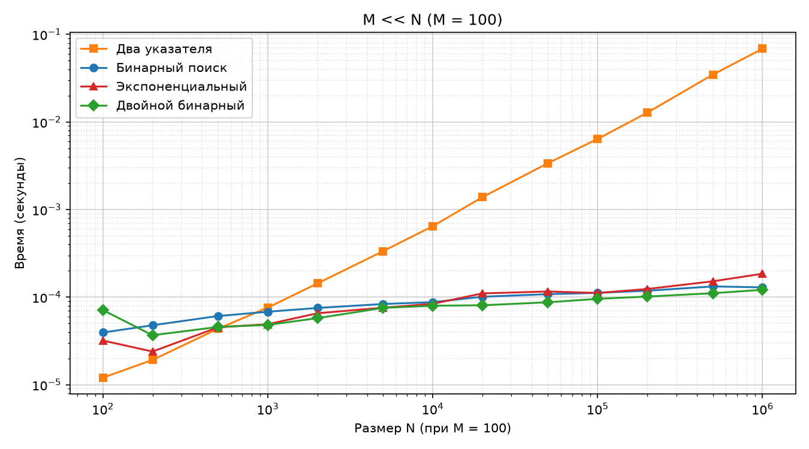
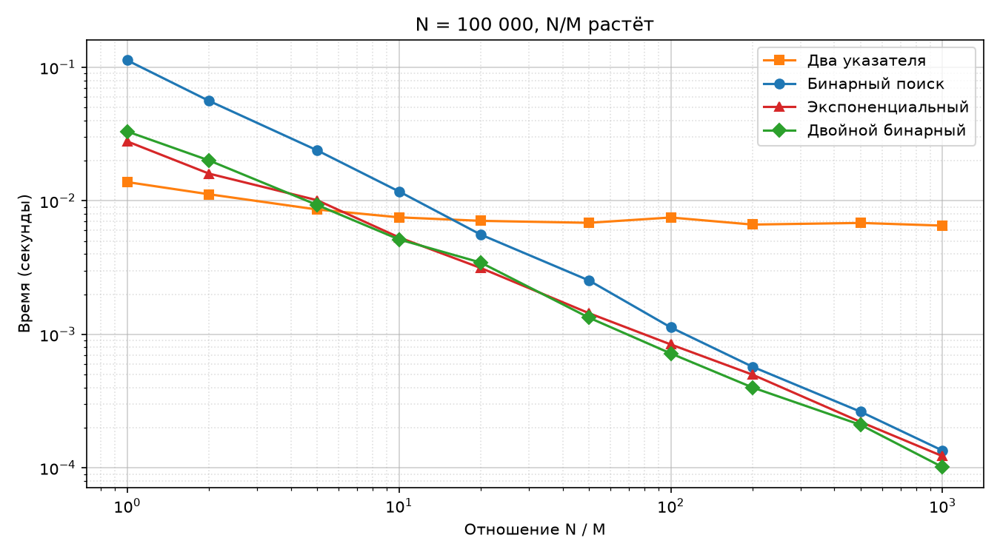

# Лабораторная работа №1: Поиск общего элемента в двух отсортированных массивах

## Задачи проекта

Даны два отсортированных массива целых чисел длины `M` и `N`. Необходимо определить, есть ли в них хотя бы один общий элемент.

**Цель:** реализовать четыре разных решения задачи и выяснить, при каком соотношении размеров массивов какой алгоритм эффективнее.

## Архитектура проекта

- `src/algorithms.py` — реализация 4 алгоритмов (два указателя, бинарный, экспоненциальный, двойной бинарный)
- `src/generator.py` — генерация тестовых данных
- `src/benchmark.py` — замеры времени, результат сохраняется в `data/results.csv`
- `src/plot.py` — построение графиков по данным из CSV (логарифмические оси)
- `tests/test_algorithms.py` — тесты на корректность
- `data/` — сырые замеры (`results.csv`)
- `plots/` — сгенерированные графики

## Как устроены данные и замеры

- Массив `a` длины `N` состоит из чётных чисел `0, 2, 4, …`.
- Массив `b` длины `M` состоит из равномерно распределенных нечётных чисел, поэтому общих элементов нет (худший случай).
- Для каждой пары размеров замерялось **среднее** время (таймер `time.perf_counter()`) из 100 запусков (для больших массивов — из 10), чтобы устранить влияние фоновых процессов ОС. Перед замерами выполнялся прогрев (один холостой запуск).
- Все результаты замеров сохраняются в файл data/results.csv, где для каждого алгоритма указан его размер, отношение размеров массивов и затраченное время в секундах.

## Сценарии тестирования

1. **M = N (равные размеры):** размеры от 100 до 100 000.
2. **M = 100, N растет (асимметрия):** `M` фиксировано = 100, `N` от 100 до 1 000 000.
3. **Зависимость от N/M:** `N` фиксировано на 100 000, `M` уменьшается так, чтобы отношение `N/M` росло от 1 до 1000.

## Анализ тестов и графики

#### 1) Массивы одинакового размера (M = N)

При M = N побеждает **два указателя** (один линейный проход). **Бинарный поиск** делает N поисков, поэтому проигрывает. **Двойной бинарный** теряет время на рекурсию. **Экспоненциальный** тратит время на прыжки перед бинарным поиском и на сам бинпоиск.

#### 2) Сильно асимметричные массивы (M = 100, N растет)

При фиксированном малом M = 100 время **двух указателей** линейно растет вместе с N, так как алгоритм вынужден шаг за шагом просматривать весь огромный массив. Остальные три алгоритма работают практически мгновенно. Лучший результат здесь показывает **двойной бинарный поиск**, так как он рекурсивно отсекает огромные куски массива. На N = 1 000 000 два указателя проигрывают ему более чем в 100 раз.

#### 3) Зависимость от соотношения N / M

**Два указателя** идут горизонтально, так как им нужно пройти весь массив N, а он фикисрован. Бинарные алгоритмы с ростом N/M падают вниз, и при N/M от 10 и выше они начинают выигрывать. **Двойной бинарный поиск** показывает наилучший результа.

---

## Главный ответ на задачу

1. **Малые и сопоставимые массивы (M = N):**
   - **Победитель:** Два указателя.
   - **Почему:** Один линейный проход `O(M+N)` всегда быстрее, чем множество отдельных логарифмических поисков.

2. **Сильная асимметрия (N/M >= 10):**
   - **Победитель:** Двойной бинарный поиск.
   - **Почему:** Бинарные алгоритмы не проходят по огромному массиву пошагово, а делят его пополам. При этом двойной бинарный за счет рекурсии отсекает куски даже эффективнее обычного. На N=100 000 и M=100 бинарные алгоритмы работают в десятки раз быстрее двух указателей.

3. ** Уточнение по двойной бинарному поиску:**
   - Проигрывает бинарному поиску по памяти из-за рекурсии, поэтому если память важна, то лучше использовать обычный бинарный. 

> **Итог:** Если массивы небольшие и одинаковые — два указателя. Если один массив гигантский, а другой крошечный — бинарный/двойной бинарный поиск.
