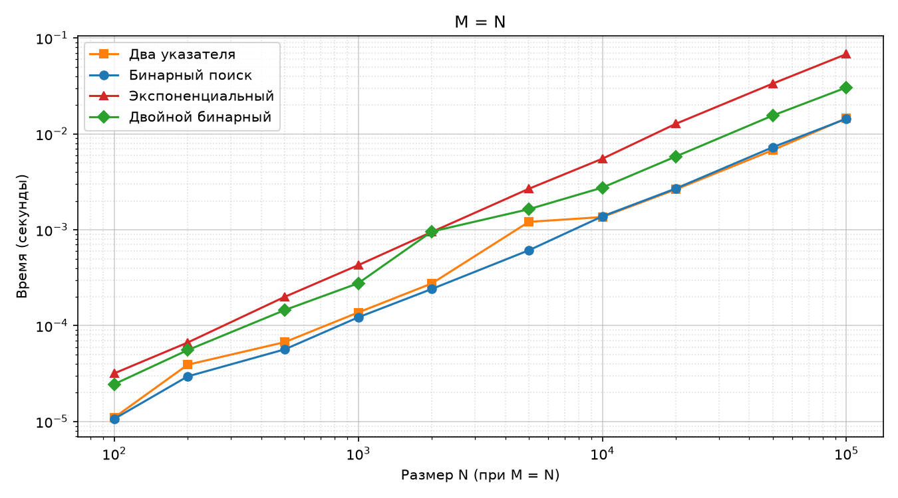
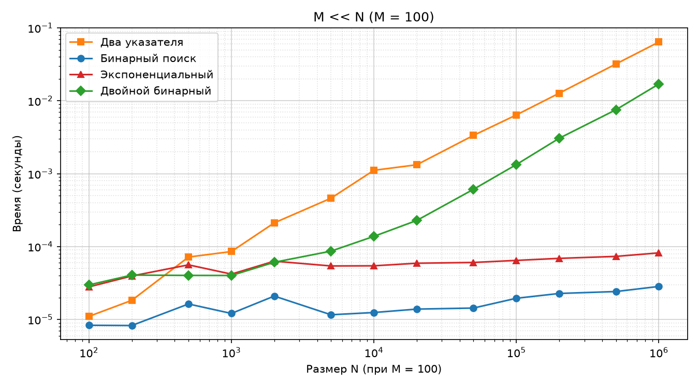
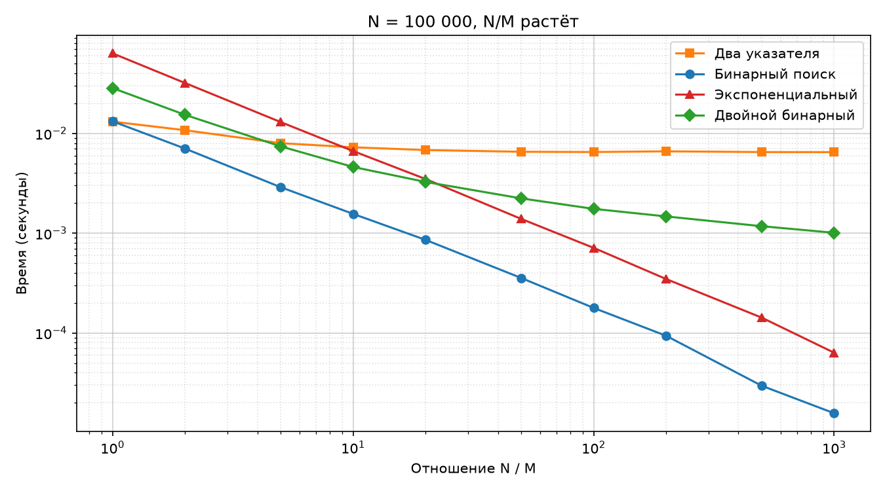

# Лабораторная работа №1: Поиск общего элемента в двух отсортированных массивах

## Задачи проекта

Даны два отсортированных массива целых чисел длины `M` и `N`. Необходимо определить, есть ли в них хотя бы один общий элемент.

**Цель:** реализовать четыре разных решения задачи и выяснить, при каком соотношении размеров массивов какой алгоритм эффективнее.

## Архитектура проекта

- `src/algorithms.py` — реализация 4 алгоритмов (два указателя, бинарный, экспоненциальный, двойной бинарный)
- `src/generator.py` — генерация тестовых данных
- `src/benchmark.py` — замеры времени, результат сохраняется в `data/results.csv`
- `src/plot.py` — построение графиков по данным из CSV (логарифмические оси)
- `tests/test_algorithms.py` — тесты на корректность
- `data/` — сырые замеры (`results.csv`)
- `plots/` — сгенерированные графики

## Как устроены данные и замеры

- Массив `a` длины `N` состоит из чётных чисел `0, 2, 4, …`.
- Массив `b` длины `M` состоит из нечётных чисел, равномерно распределённых по диапазону `a`, поэтому общих элементов нет (худший случай).
- Для каждой пары размеров замерялось **среднее** время (таймер `time.perf_counter()`) из 100 запусков (для больших массивов — из 10), чтобы устранить влияние фоновых процессов ОС и случайных выбросов. Перед замерами выполнялся прогрев (один холостой запуск).
- Таблица `results.csv` содержит колонки `scenario`, `M`, `N`, `ratio` (= `N / M`), `algorithm`, `time_sec`.

## Сценарии тестирования

1. **M = N (равные размеры):** размеры от 100 до 100 000.
2. **M = 100, N растет (асимметрия):** `M` фиксировано на 100, `N` от 100 до 1 000 000.
3. **Зависимость от N/M:** `N` фиксировано на 100 000, `M` уменьшается так, чтобы отношение `N/M` росло от 1 до 1000.

## Анализ тестов и графики

#### 1) Массивы одинакового размера (M = N)

При равных размерах массивов **два указателя** и **бинарный поиск** показывают близкие результаты. Разница между ними становится заметной только на больших `N` (от 10 000). **Экспоненциальный** и **двойной бинарный** поиски работают медленнее из-за накладных расходов на рекурсию и дополнительные вызовы `bisect`.

#### 2) Сильно асимметричные массивы (M = 100, N растет)

При фиксированном малом `M = 100` время **двух указателей** линейно растет вместе с `N`, так как алгоритм вынужден шаг за шагом просматривать весь огромный массив `N`. Остальные три алгоритма работают практически за константное время. На \(N = 1 000 000\) два указателя проигрывают бинарному поиску более чем в 100 раз.

#### 3) Зависимость от соотношения N / M

График показывает точку перелома. Пока массивы сопоставимы по размеру (при \(N/M \le 5\)), быстрее работают **два указателя**. Но как только отношение \(N/M\) превышает 10–20, кривые пересекаются, и **бинарный**, **экспоненциальный** и **двойной бинарный** поиски начинают выигрывать.

---

## ГЛАВНЫЙ ОТВЕТ НА ЗАДАЧУ (Какой алгоритм когда использовать)

По результатам замеров и графиков можно сделать следующие выводы об эффективности:

1. **Когда массивы сопоставимы по размеру (\(N/M \le 5\))**:
   - **Победитель: Два указателя.** 
   - *Почему:* Один линейный проход \(O(M+N)\) работает быстрее, чем \(M\) вызовов логарифмического поиска. Бинарный поиск делает слишком много лишних операций.

2. **Когда один массив сильно больше другого (\(N/M \ge 20\))**:
   - **Победитель: Бинарный поиск и Двойной бинарный поиск.**
   - *Почему:* Они не проходят по огромному массиву пошагово, а делят его пополам. На миллионе элементов они работают в десятки раз быстрее двух указателей.
   - *Нюанс:* Двойной бинарный требует дополнительную память \(O(\log M)\) под рекурсию, а обычный бинарный — нет (память \(O(1)\)).

3. **Экспоненциальный поиск**:
   - В данной реализации он немного проигрывает обычному бинарному из-за частых вызовов встроенного `bisect`. Он хорош теоретически (\(O(M \log(2N/M))\)), но на практике обычный бинарный проще и быстрее.

> **Итог:** Если массивчики маленькие и одинаковые — берите два указателя. Если один массив гигантский, а другой крошечный — берите бинарный поиск.
